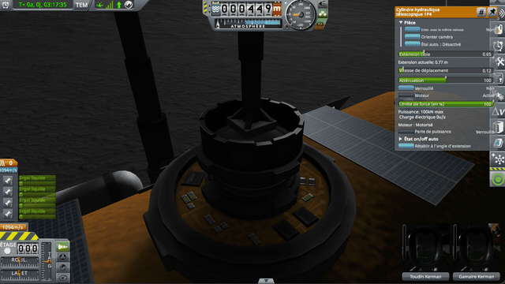
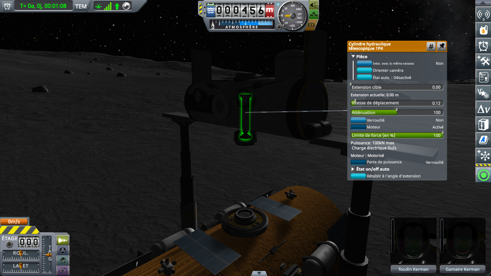
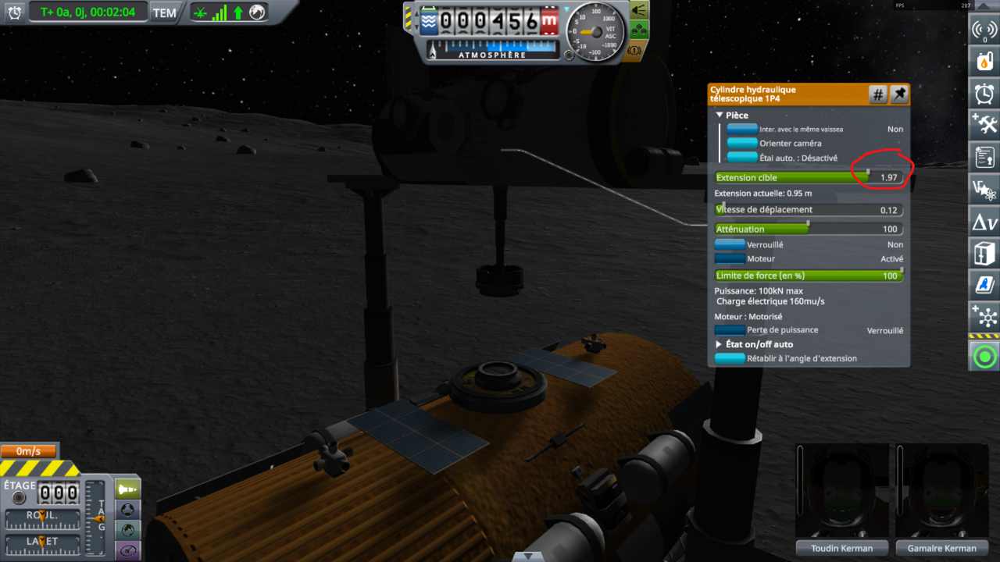
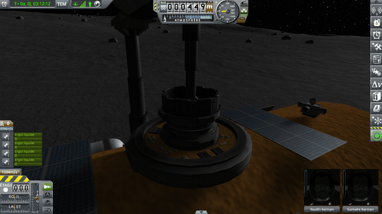

# Robotics Tip Gap Fix

**⚠️ Not finished yet.** This is a new fix, not a finished mod. The code and the conclusions on this page can still change.

A fix for stock KSP 1.12, kept as small as possible: one Harmony transpiler, in one source file. It is a mod of its
own, built on top of [KSP Community Fixes](https://github.com/KSPModdingLibs/KSPCommunityFixes), the base most players
run. Here is what it fixes:

> **A part at the tip of a robotic part can hang away from it.** A docking port at the end of a piston catches a
> vessel; when the piston lifts it, the port moves away from the piston's tip, as if held by a spring, and a gap opens
> between them. The more the piston was extended when the port docked, the wider the gap.



*KSP 1.12 with KSP Community Fixes, Terrain Precision Fix and Robotics Load Shift Fix, without this mod, the protocol
of [Checking the culprit](#checking-the-culprit), the tanker lifted; the mouse goes over the tanker's port, the crane's
port, then the piston, to highlight each.*

The attachment between the two parts pivots around the wrong point, beside the robotic part instead of at their attach
node: see [The culprit](#the-culprit). This mod puts that point back on the node.

**How this was made.** The investigation and the code were written with Claude, Anthropic's AI
assistant. Everything here was reviewed and validated by a human — me. I am saying so up front, because
contributions made with an AI deserve a closer look than others, and because some people would rather
stop reading here. That look should be quick: the stock code involved is named and quoted on this page, and the fix
removes two assignments from one stock method, in one source file you can read in a few minutes.

## Why it matters

A piston with a docking port at its end is the usual way to build a crane, a refuelling arm or a rover hitch: extend
the piston, dock, retract it to lift. That is exactly the case that goes wrong. The gap opens under load, while the
parts still look aligned: the port stays straight, it just is not at the tip any more.

Saving and loading does not close it cleanly. The game rebuilds the vessel from the saved part positions, port back at
the tip, the rest of the vessel moved by the width of the gap: on the ground, the crane's wheels can end up in the
terrain, and the vessel jumps.

It takes no docking: a robotic part attached in the editor by its moving side (a piston hung under a part by the end
of its rod, a piston on a hinge mounted by its rod) has the same faulty attachment, every time the vessel loads. It
then shows as a robotic part that holds less well than it should under load.

## The culprit

Two parts are held together by a `ConfigurableJoint`, created by `PartJoint`. `PartJoint.create` gives
`PartJoint.SetupJoint` the position and axes of the attach node in the frame of the child part. When the child is a
robotic part attached by its moving side, `SetupJoint` puts the joint on the rigidbody of that moving side, as it
should, but also starts reading the node position in another frame, the one of the moving object:

```csharp
// PartJoint.SetupJoint (KSP 1.12), when the child is a robotic part attached by a stack node of its moving side
rigidbody = servo2.AttachServoRigidBody((nodeToParent != null) ? nodeToParent : nodeFromParent);
if (rigidbody != target.Rigidbody)
{
    gameObject = rigidbody.gameObject;
    partTransform = servo2.MovingObject().transform;   // the node position is not in this frame
    rigidbody = target.Rigidbody;
}
// ...
hostAnchor = gameObject.transform.InverseTransformPoint(partTransform.TransformPoint(jointPos));
tgtAnchor = configurableJoint.connectedBody.transform.InverseTransformPoint(partTransform.TransformPoint(jointPos));
```

A surface node takes the same turn, through `servo2.NodeRigidBody(node)`.

The moving object of a piston is turned in its model, and shifted by its extension; the node position, kept up to date
with the extension by `BaseServo`, counts it too. The point the joint is built on ends up beside the piston, a few
metres from the node when the piston is extended. Both anchors are computed on that same point, so nothing moves when
the joint is created, and nothing looks wrong. But the joint now pivots around it: under load, the small twist every
joint takes becomes, at the end of that long lever, a shift of the tip part along the piston's axis.

## Checking the culprit

KSP 1.12.5 with the Breaking Ground expansion, [KSP Community Fixes](https://github.com/KSPModdingLibs/KSPCommunityFixes)
1.41.1, [Terrain Precision Fix](https://github.com/lhervier/KSP-Fix-TerrainPrecision) and
[Robotics Load Shift Fix](https://github.com/lhervier/KSP-Fix-RoboticsLoadShift). The last two are what lets the
save load as it was made: without them, the crane, landed on the Mun with its arm carrying the piston, jumps when the
save loads. Copy [tip-gap.sfs](diag/tip-gap.sfs) into the folder of a sandbox game and load it. Two vessels are
landed on the Mun, side by side:

- **Base 1.25D - Grue**, the active vessel: a crane on wheels. At the end of its arm, a 1P4 piston, retracted,
  unlocked, motor engaged, hangs a Clamp-O-Tron Jr docking port.
- **Base Mu Rav. ElOx**, a tanker, on the ground right under the crane, its own Clamp-O-Tron Jr facing up, aligned
  with the crane's, not docked.



*The save as it loads, the part action window of the 1P4 piston open.*

Then, by hand:

1. In the part action window of the 1P4 piston, set **Target extension** to **1.97**. The piston extends slowly, at
   its traverse rate of 0.12 m/s.



*Target extension set to 1.97, the piston on its way down.*

2. Near the end of its travel, the two ports dock. Nothing shows yet: the tanker still rests on the ground.
3. **Lift the tanker:** set **Target extension** to **0.65**. The piston retracts and the tanker comes off the ground,
   hanging from the crane's port. The gap only opens under that load.
4. Point the mouse at each part in turn, the tanker's port, the crane's port, the piston: the game highlights it.

| Without this mod | With this mod |
|---|---|
|  |  |

*After step 4: the tanker lifted, target extension 0.65; same save, same steps.*

- **Without this mod:** with the tanker hanging from it, the crane's port no longer sits at the tip of the piston: it is
  shifted down, and the piston's rod ends well above it.
- **With this mod:** the port stays at the tip of the piston.

<!-- Possibly Diag PartFlex to show the stretch of the joint at the node. -->

At `Debug` (see [Settings](#settings)), `KSP.log` gets one line each time the joint of a robotic part is created,
with its distance to the attach node:

```
[KSPFixRoboticsTipGap] [DEBUG] Joint of piston.04 (…) to dockingPort3 (…) on TopJoint, anchor (…), connected anchor (…), 0.000 m from the node
```

With `anchorJointAtNode = False`, the same line gives the stock distance.

## The fix

One transpiler, with its switch in [Settings](#settings), on by default. Nothing is saved; removing the mod gives the
stock behaviour back at once.

- **`anchorJointAtNode`.** A transpiler on `PartJoint.SetupJoint` removes the two assignments that replace the frame
  of the node position for a robotic child, the moving object for a stack node and the node rigidbody for a surface
  node. The node position is then read in the frame it is given in, the child part's, and the joint is built at the
  node, wherever the moving side stands. The joint stays on the same body, with the same strength: only the point it
  pivots around changes.

The transpiler checks the shape of the stock method before changing it: if it is not the one expected, nothing is
patched, with an error in `KSP.log`.

## Work in progress

What a player would see if this mod broke something, or what it should fix but was not checked yet, and how to try
it by hand, with the mod and without:

- **A hinge or a rotation servo attached by its moving side**, carrying a load: with the mod, the part it carries
  should stay at its tip, as with a piston.
- **A part surface-attached to the moving side of a robotic part**, when the robotic part hangs from it: same.
- **Docking and undocking a few times** with a port at the tip of a piston: with the mod, the port should dock and
  undock as on stock, and stay at the tip each time.

## Install

Copy the `GameData\KSPFixRoboticsTipGap` folder into the `GameData` folder of KSP. It needs
[Harmony](https://github.com/KSPModdingLibs/HarmonyKSP), as KSP Community Fixes does. It only acts on the robotic
parts of the Breaking Ground expansion.

## Settings

`GameData\KSPFixRoboticsTipGap\PluginData\settings.cfg` is read once, when KSP starts:

```
// Anchors the attachment of a part hanging from the moving side of a robotic part at their attach node.
anchorJointAtNode = True

// How much the mod writes to KSP.log: Error, Warning, Info or Debug.
logLevel = Info
```

- With `anchorJointAtNode = False`, nothing is patched: the joint is built where the stock code puts it.
- At `Debug`, the mod writes one line each time the joint of a robotic part is created, with its distance to the
  attach node.

## Build

Set `KSPDIR` to the folder of a KSP install with Harmony in its `GameData`, then run `build.bat`: it
compiles `GameData\KSPFixRoboticsTipGap\KSPFixRoboticsTipGap.dll`. Installing is up to you.

## License

[MIT](LICENSE).
